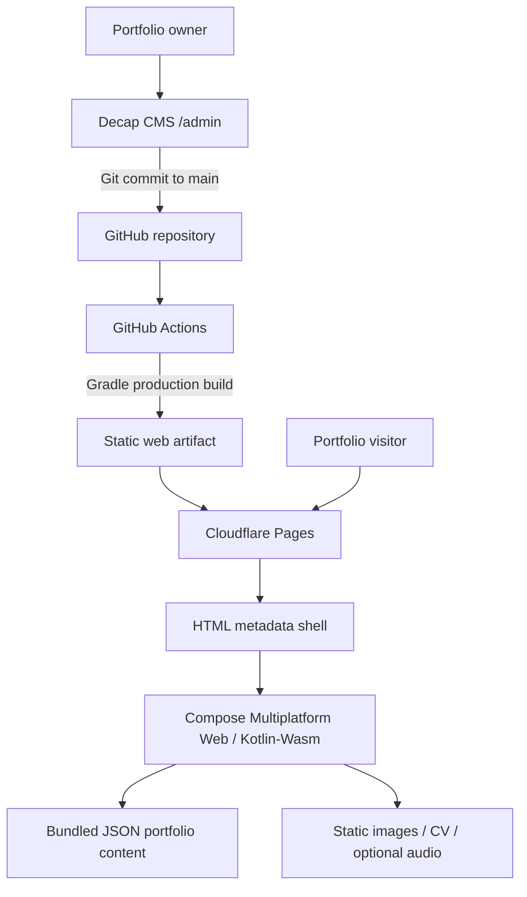

# Architecture — Kotlin Multiplatform Mobile Developer Portfolio

## 1. Architecture summary
A static, client-rendered Compose Multiplatform portfolio with KMP-shared typed content models, version-controlled JSON content, Decap CMS editing, and automated Cloudflare Pages deployment.

### High-level flow


## 2. Stack
| Layer | Choice | Responsibility |
|---|---|---|
| Language | Kotlin | Application and shared models |
| Multiplatform | Kotlin Multiplatform | Shared content/domain code |
| UI | Compose Multiplatform Web (`wasmJs`) | Responsive portfolio UI |
| Serialization | kotlinx.serialization | Typed JSON decoding |
| Build | Gradle Kotlin DSL + version catalog | Reproducible build |
| CMS | Decap CMS | Non-technical editing |
| Source control | GitHub | Content history and publishing |
| CI | GitHub Actions | Build and validation |
| Hosting | Cloudflare Pages | Static hosting/CDN |
| Assets | Repository static files | Portrait, project imagery, CV, optional audio |

Pin compatible Kotlin, Compose Multiplatform, Gradle, and plugin versions after checking their current compatibility matrix. Do not let the agent guess versions independently.

## 3. KMP module structure
Start with the simplest Gradle layout that the official Compose Multiplatform template supports. Do not create a large multi-module architecture for a small portfolio.

Suggested structure:
```text
.
├── AGENTS.md
├── PRD.md
├── ARCHITECTURE.md
├── PROMPTS.md
├── settings.gradle.kts
├── build.gradle.kts
├── gradle/
│   └── libs.versions.toml
├── composeApp/
│   └── src/
│       ├── commonMain/kotlin/
│       │   ├── domain/model/
│       │   ├── data/
│       │   ├── ui/
│       │   │   ├── theme/
│       │   │   ├── components/
│       │   │   └── sections/
│       │   └── app/
│       ├── commonTest/kotlin/
│       └── wasmJsMain/
│           ├── kotlin/
│           └── resources/
├── content/
│   ├── site.json
│   ├── skills.json
│   ├── projects.json
│   ├── services.json
│   ├── experience.json
│   └── links.json
├── public/
│   ├── images/
│   ├── cv/
│   ├── audio/          # optional; only if audio remains in scope
│   ├── admin/
│   │   ├── index.html
│   │   └── config.yml
│   ├── index.html       # if generated by the chosen template, preserve and enhance it
│   └── favicon/
├── .opencode/
│   └── agents/
├── .github/workflows/
│   └── deploy.yml
└── docs/
    ├── decisions/
    └── checklists/
```

The generated template may use a different module name or resource directory. Preserve its working conventions and adapt this map rather than forcing a rewrite.

## 4. Domain and content model
Keep data independent from UI. Suggested model types:
- `SiteContent`: identity, role, hero copy, summary, metrics, footer.
- `SkillGroup`: group name, category, ordered skill items.
- `Project`: id/slug, title, summary, problem, solution, impact, tags, image, optional URL.
- `Service`: title, description, highlights.
- `Experience`: role, company, location, start/end dates, bullets, tags.
- `SocialLink`: label, URL, icon key.

Use `@Serializable` models. Validate:
- Unique project IDs/slugs.
- Valid URL schemes (`https`, `mailto`) and reject unsafe schemes.
- Non-empty required fields.
- Optional metrics only when verified.
- Asset paths are local, expected paths and do not traverse directories.

## 5. Content pipeline
Preferred first implementation:
1. Decap CMS edits JSON files in `content/`.
2. CMS commits changes to `main`.
3. Gradle packages JSON as application resources, or a small build task copies validated JSON into the web resource directory.
4. Kotlin data repository decodes bundled JSON at runtime.
5. Static assets are served from the public web root.

Do not add YAML parsing unless there is a compelling CMS or tooling reason. JSON is directly compatible with Kotlin serialization and can be edited by Decap's file-based collections. Prove this with one small collection before expanding.

### Repository boundary
```text
PortfolioRepository
  └── PortfolioContentSource
       ├── loads packaged JSON resources
       └── decodes typed models
```
UI composables receive typed state/data and do not read files directly.

## 6. UI architecture
- `PortfolioApp`: root theme and page composition.
- `PortfolioPage`: ordered sections and responsive layout.
- `SiteHeader`: desktop navigation and mobile menu.
- `HeroSection`
- `MetricsSection`
- `AboutSection` / `ProfileMatrix`
- `ProjectsSection` / `ProjectCard`
- `ServicesSection` / `ServiceCard`
- `ExperienceSection` / `ExperienceTimeline`
- `ContactSection` / `SiteFooter`
- Shared primitives: `SectionHeading`, `TagChip`, `MetricCard`, `SurfaceCard`, `PrimaryButton`, `SecondaryButton`.

### Responsive strategy
- One composable tree.
- Centralized breakpoints.
- Desktop: horizontal header, two-column hero/profile, multi-column skill/project/service grids.
- Tablet: reduced columns and spacing.
- Mobile: stacked hero, compact nav/menu, one-column cards, readable typography.
- Use adaptive layout decisions rather than hardcoding separate device pages.
- Confirm actual viewport sizing and overflow in browser tests.

### Design tokens
Create a single theme source for:
- Background and surface colors.
- Primary cyan and secondary pink accents.
- Text primary/secondary/muted.
- Borders and subtle glows.
- Typography scale and weights.
- Spacing scale.
- Corner radii.
- Content max width.
- Responsive breakpoints.

Extract exact values from Stitch where possible; do not eyeball each component independently.

## 7. Web platform boundary
Compose Multiplatform Web/Wasm is the initial target. Keep browser interop small and isolated:
- Download link behavior.
- External navigation.
- Optional audio playback.
- Reduced-motion/browser preference access if required.
- Document title/metadata updates only if needed.

Prefer ordinary browser links for navigation and downloads. Avoid custom JS unless Compose APIs cannot provide a reliable accessible behavior.

### SEO and semantic HTML risk
A Compose/Wasm application may not provide the same crawlability as a statically rendered HTML site. Keep title, description, canonical, Open Graph tags, favicon, and a meaningful `noscript` fallback in the static HTML shell. Inspect the rendered DOM and test crawler output. If semantic structure or SEO is materially inadequate, use a stable web-native approach rather than spending excessive effort on workarounds.

## 8. CMS and deployment
### Decap CMS
- Publish route: `/admin/`.
- Backend: GitHub.
- Branch: `main` for the agreed direct-publishing workflow.
- Collections: site, skills, projects, services, experience, links.
- Media folder: `public/images`; public path: `/images`.
- Restrict CMS access to the portfolio owner.
- Confirm authentication and Git provider setup with the current Decap documentation; never commit OAuth secrets.

### Cloudflare Pages
- Build through GitHub Actions or Cloudflare Pages Git integration, but choose one authoritative deployment path to avoid duplicate deployments.
- Build command must be the verified Gradle production web distribution task.
- Output directory must be discovered from the actual Gradle artifact, not guessed.
- Set up preview deployment for pull requests or a staging branch if supported by the chosen deployment configuration.
- Keep `main` as production publishing branch.
- Add a CI check that validates content JSON before deployment.

## 9. Testing strategy
- Common unit tests: serialization, required-field validation, URL validation, ordering.
- UI/manual tests: responsive section layout, nav/menu, CTA actions, missing optional fields.
- Browser tests: desktop/mobile viewport smoke tests, keyboard navigation, focus, no overflow, no console errors.
- Accessibility: automated scan plus manual keyboard/contrast review.
- Deployment tests: direct CV URL, image URLs, refresh, `/admin/`, page metadata.
- Performance: measure first production artifact and image payload; set budgets based on actual baseline.

## 10. Architecture decision records
### ADR-001: Compose Multiplatform Web/Wasm
**Decision:** Use Compose Multiplatform Web/Wasm initially because the project explicitly aims to demonstrate KMP and Jetpack Compose.

**Context:** Kotlin/Wasm and Compose Multiplatform Web are Beta. Android/iOS/desktop targets are more mature. Kotlin/JS is stable, but Compose HTML is a DOM-oriented alternative and not the same shared Compose UI framework.

**Consequences:** Validate browser support, accessibility, SEO, and hosting in the first technical spike. Isolate web-specific code. Define a stop/go gate before investing in detailed UI.

### ADR-002: Static content + Decap CMS
**Decision:** Store portfolio data in JSON committed to Git; Decap CMS edits these files; deployment builds a static site.

**Consequences:** No database or runtime API. Content changes are auditable in Git. CMS auth/configuration must be tested early.

### ADR-003: One responsive page
**Decision:** Implement one responsive Compose page from desktop and mobile Stitch references.

**Consequences:** Shared content and components; breakpoints adapt composition. Do not fork the site into two separate UIs.

### ADR-004: CV as a static asset
**Decision:** Serve the approved PDF from `public/cv/`.

**Consequences:** Deployment is simple and reliable. Updating the CV is a repository asset change; verify the public URL after deploy.
